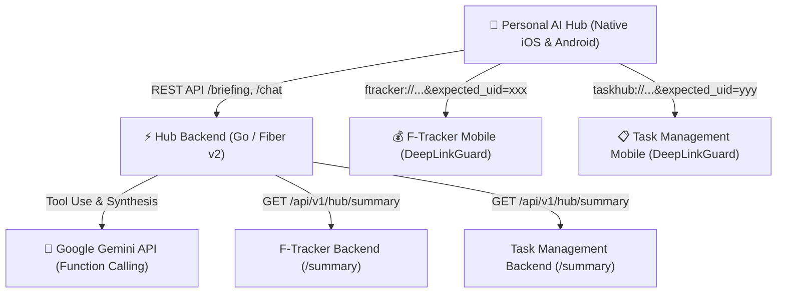
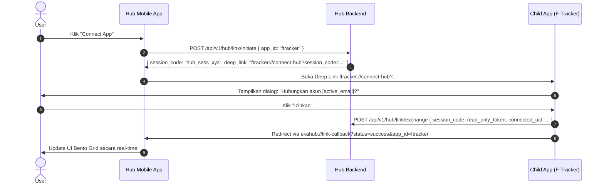

# Personal AI Hub (Life Aggregator) Architecture

Personal AI Hub adalah agregator kehidupan modular yang mengkonsolidasikan data dari aplikasi satelit independen (saat ini: **F-Tracker** untuk keuangan dan **Task Management** untuk tugas harian).

---

## 1. Arsitektur Sistem & Komponen



### Jawaban: Apakah aplikasi anak hanya butuh Backend saja?
> **Tidak hanya BE.** 
> - **Di sisi Backend Anak (F-Tracker & Task Management):** Memang **cukup menambahkan 1 endpoint modular**, yaitu `GET /api/v1/hub/summary` (diproteksi `read_only_token`).
> - **Di sisi Mobile Anak (F-Tracker & Task Management):** **Wajib memasang `DeepLinkGuard` / Interceptor** untuk membaca parameter `expected_uid`. Jika tidak dipasang di mobile anak, aplikasi tidak bisa mendeteksi kondisi **Account Mismatch** ketika user berganti akun di tengah jalan.

---

## 2. Standar Kontrak Data Modular (`GET /api/v1/hub/summary`)

Setiap aplikasi satelit mengimplementasikan response schema standar ini:

```json
{
  "app_id": "ftracker",
  "app_name": "F-Tracker",
  "connected_uid": "usr_ftracker_123",
  "connected_email": "eka@finance.app",
  "highlight_metric": "Rp 4.250.000",
  "highlight_label": "Pengeluaran Bulan Ini",
  "ai_context_data": {
    "monthly_spent": 4250000,
    "budget_limit": 10000000,
    "remaining_budget": 5750000,
    "top_category": "Food & Beverage",
    "overbudget_warning": false
  },
  "deep_link": "ftracker://expenses?category=food&expected_uid=usr_ftracker_123"
}
```

---

## 3. Alur Account Linking (OAuth-like via Deep Link Handshake)



---

## 4. Penanganan "Account Mismatch" (DeepLinkGuard)

Setiap navigasi dari Hub menyertakan `expected_uid`:
`ftracker://expenses?category=food&expected_uid=usr_123&expected_email=eka@finance.app`

`DeepLinkGuard` di sisi aplikasi penerima mengevaluasi:
1. **`current_uid == expected_uid`**: Langsung izinkan navigasi ke halaman tujuan.
2. **`current_uid == null`**: Simpan URL di `pending_deep_link`, arahkan ke Login screen dengan pesan *"Harap login dengan akun yang terhubung ke Hub"*. Setelah login berhasil, teruskan ke `pending_deep_link`.
3. **`current_uid != expected_uid` (User ganti akun):** **Jangan auto-logout!** Tampilkan BottomSheet 3 opsi:
   - **Opsi 1: "Ganti ke Akun [expected_email]"** → Logout akun aktif, simpan pending link, arahkan ke Login.
   - **Opsi 2: "Perbarui Koneksi Hub ke Akun Saat Ini ([current_email])"** → Panggil Hub API `PUT /api/v1/hub/link/update`, lalu buka halaman tujuan.
   - **Opsi 3: "Batal"** → Tetap di akun saat ini, batalkan navigasi.

Implementasi siap pakai tersedia di:
- **Android Kotlin**: `android/app/src/main/java/cloud/eka_dev/eka_hub/guard/ChildAppDeepLinkGuard.kt`
- **iOS Swift**: `ios/EkaHub/Guard/ChildAppDeepLinkGuard.swift`
- **Flutter (GetX)**: `integration/flutter/hub_deep_link_guard.dart`

---

## 5. Google Gemini API Function Calling & MCP Tool Calling Engine

Skema Tool Declarations yang disediakan ke Gemini dan didukung oleh Dispatcher MCP:

```json
{
  "function_declarations": [
    {
      "name": "create_task",
      "description": "Create a new actionable task directly in Task Management app pipeline.",
      "parameters": {
        "type": "OBJECT",
        "properties": {
          "title": { "type": "STRING", "description": "Task title or description of what needs to be done." },
          "description": { "type": "STRING", "description": "Optional markdown details." },
          "priority": { "type": "STRING", "description": "Priority: 'low', 'medium', 'high', 'urgent'." },
          "due_date": { "type": "STRING", "description": "Deadline (ISO-8601 or YYYY-MM-DD)." },
          "is_focus": { "type": "BOOLEAN", "description": "Pin to Today's Focus." },
          "tags": { "type": "ARRAY", "items": { "type": "STRING" } }
        },
        "required": ["title"]
      }
    },
    {
      "name": "create_transaction",
      "description": "Record a new expense or income transaction in F-Tracker finance app.",
      "parameters": {
        "type": "OBJECT",
        "properties": {
          "amount": { "type": "NUMBER", "description": "Numerical amount in IDR." },
          "type": { "type": "STRING", "description": "Type: 'expense' or 'income'." },
          "description": { "type": "STRING", "description": "Transaction description." },
          "category": { "type": "STRING", "description": "Category name, e.g. Food, Transportation." },
          "date": { "type": "STRING", "description": "Optional date YYYY-MM-DD." }
        },
        "required": ["amount", "type", "description"]
      }
    },
    {
      "name": "list_tasks",
      "description": "Retrieve tasks filtered by status, priority, or focus from Task Management.",
      "parameters": {
        "type": "OBJECT",
        "properties": {
          "status": { "type": "STRING", "description": "backlog, todo, in_progress, review, done." },
          "priority": { "type": "STRING", "description": "low, medium, high, urgent." },
          "is_focus": { "type": "BOOLEAN" },
          "search": { "type": "STRING" },
          "limit": { "type": "INTEGER" }
        }
      }
    },
    {
      "name": "update_task_status",
      "description": "Update the status of an existing task in Task Management.",
      "parameters": {
        "type": "OBJECT",
        "properties": {
          "task_id": { "type": "INTEGER" },
          "status": { "type": "STRING", "description": "backlog, todo, in_progress, review, done." }
        },
        "required": ["task_id", "status"]
      }
    },
    {
      "name": "get_financial_summary",
      "description": "Retrieve current financial metrics from F-Tracker including total expenses, remaining monthly budget, and top spending categories.",
      "parameters": {
        "type": "OBJECT",
        "properties": {
          "month": { "type": "STRING", "description": "Optional month in YYYY-MM format." },
          "category": { "type": "STRING", "description": "Optional category filter." }
        }
      }
    },
    {
      "name": "generate_cross_app_action",
      "description": "Generate an authenticated, safe deep link with expected_uid to navigate the user directly into a child app.",
      "parameters": {
        "type": "OBJECT",
        "properties": {
          "app_id": { "type": "STRING", "description": "Target app: 'ftracker' or 'taskmanagement'." },
          "target_route": { "type": "STRING", "description": "Target screen route." },
          "action_title": { "type": "STRING", "description": "Short user-facing action title." },
          "query_params": { "type": "STRING", "description": "Optional query string like 'category=food'." }
        },
        "required": ["app_id", "target_route", "action_title"]
      }
    }
  ]
}
```

### Mekanisme Eksekusi Tool (JSON-RPC 2.0 MCP Dispatcher):
1. **Gemini Function Calling Loop**: Model memilih tool -> Hub memanggil `ExecuteTool` -> Memanggil MCP endpoint child app via JSON-RPC 2.0 (`POST {api_base_url}/api/v1/mcp` atau `{api_base_url}/api/v1/hub/mcp`) -> Mengirim hasil kembali ke Gemini -> Gemini menghasilkan teks konfirmasi ramah dengan SuggestedAction Deep Link.
2. **Smart Local Dispatcher (Offline / Fallback)**: Menggunakan heuristik deteksi intent ("buat task ...", "catat pengeluaran ...", "jadwal hari ini") untuk mengeksekusi tool langsung tanpa API key Gemini.
3. **Endpoint Akses Langsung**:
   - `GET /api/v1/hub/tools`: Daftar seluruh tool aktif dari aplikasi satelit.
   - `POST /api/v1/hub/tools/call`: Eksekusi tool langsung oleh client atau agent AI.

