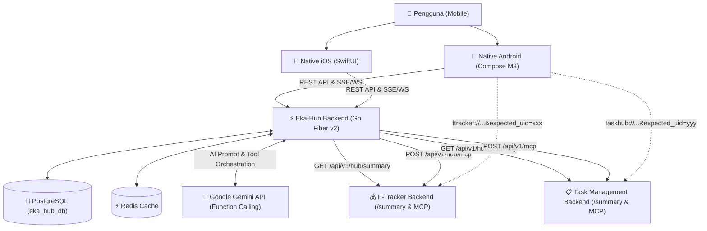

# 🌐 Eka-Hub (Personal AI Hub & Life Aggregator)

**Eka-Hub** adalah agregator kehidupan cerdas (Life Aggregator) modular berbasis AI yang mengintegrasikan data aktivitas produktivitas dan keuangan harian dari aplikasi satelit independen:
- 💰 **F-Tracker**: Aplikasi manajemen finansial & transaksi pengeluaran.
- 📋 **Task Management**: Aplikasi pelacak tugas, proyek, dan to-do list harian.

Eka-Hub menyatukan metrik lintas aplikasi ke dalam satu **Bento Grid Dashboard**, menyajikan **Daily AI Briefing** otomatis, serta menyediakan **Cross-App AI Chat** menggunakan Google Gemini Function Calling dan Model Context Protocol (MCP) JSON-RPC 2.0.

---

## 🏗️ Arsitektur Sistem



---

## 📁 Struktur Monorepo

```
eka-hub/
├── backend/                   # Go Fiber v2 REST API & AI Hub Engine
│   ├── cmd/server/            # Main server entrypoint
│   ├── cmd/migrate.go         # Migration CLI
│   ├── internal/module/hub/   # Hub module: Gemini Tools, MCP Dispatcher, Aggregator
│   ├── migrations/            # SQL migration files
│   └── Dockerfile             # Multi-stage production container
├── android/                   # Native Android Jetpack Compose (Material 3)
│   └── app/src/main/          # Compose UI (Dashboard, Chat, ConnectedApps, Guard)
├── ios/                       # Native iOS SwiftUI (Swift 6)
│   ├── EkaHub/                # SwiftUI Views, ViewModels, DeepLinkManager, Guard
│   └── EkaHub.xcodeproj/      # Xcode project configuration
├── k8s/                       # Kubernetes Manifests (Namespace, Deployment, Ingress, dll)
├── terraform/                 # Infrastructure as Code (IaC) untuk Kubernetes
├── integration/               # Sample contract & DeepLinkGuards (Flutter, Go)
└── .github/workflows/         # Isolated Multi-Platform CI/CD Pipelines
```

---

## 🚀 Panduan Menjalankan Lokal

### 1. Prasyarat
- Docker & Docker Compose
- Go 1.25+
- Node.js / NPM (opsional untuk tools)
- Android Studio / Xcode (untuk menjalankan aplikasi mobile)

### 2. Jalankan Database & Redis
```bash
cd backend
docker compose up -d
```

### 3. Jalankan Migrasi Database
```bash
go run cmd/migrate.go -action=up
```

### 4. Jalankan Backend Server
```bash
go run cmd/server/main.go
# Server berjalan di http://localhost:3000
# Health check: curl http://localhost:3000/health
```

---

## 📡 Standar Kontrak Integrasi Satelit

Setiap aplikasi satelit mengimplementasikan 2 kontrak standar:

1. **Modular Summary Contract (`GET /api/v1/hub/summary`)**:
   Mengembalikan metrik ringkas untuk kartu dashboard Bento Grid dan konteks AI harian:
   ```json
   {
     "app_id": "ftracker",
     "app_name": "F-Tracker",
     "connected_uid": "usr_123",
     "connected_email": "user@finance.app",
     "highlight_metric": "Rp 4.250.000",
     "highlight_label": "Pengeluaran Bulan Ini",
     "ai_context_data": {
       "monthly_spent": 4250000,
       "budget_limit": 10000000,
       "top_category": "Food & Beverage"
     },
     "deep_link": "ftracker://expenses?expected_uid=usr_123"
   }
   ```

2. **MCP JSON-RPC 2.0 Tool Calling**:
   - Task Management: `POST /api/v1/mcp` (`create_task`, `list_tasks`, `update_task_status`)
   - F-Tracker: `POST /api/v1/hub/mcp` (`create_transaction`, `get_financial_summary`)

3. **Pencegahan Account Mismatch**:
   Menggunakan `ChildAppDeepLinkGuard` pada mobile penerima untuk memastikan `current_uid == expected_uid`.

---

## 🚢 DevOps & Deployment

### 1. Isolated CI/CD Pipelines (GitHub Actions)
Pipeline rilis dipisahkan berdasarkan platform dengan semantic release terisolasi:

- **Backend**: `.github/workflows/deploy-backend.yml` (Tag: `backend-v${version}`, target VPS K8s)
- **Android**: `.github/workflows/deploy-android.yml` (Tag: `android-v1.0.${run_number}`, APK Release)
- **iOS**: `.github/workflows/deploy-ios.yml` (Tag: `ios-v${version}`, TestFlight)

### 2. Deployment via Kubernetes Manifests
```bash
kubectl apply -f k8s/namespace.yaml
kubectl apply -f k8s/configmap.yaml
# Buat k8s/secret.yaml dari k8s/secret.example.yaml
kubectl apply -f k8s/secret.yaml
kubectl apply -f k8s/deployment.yaml
kubectl apply -f k8s/service.yaml
kubectl apply -f k8s/ingress.yaml
```

### 3. Deployment via Terraform (IaC)
```bash
cd terraform
cp terraform.tfvars.example terraform.tfvars
# Sesuaikan isi terraform.tfvars
terraform init
terraform plan
terraform apply
```

---

## 📜 Lisensi
MIT License - Dibuat untuk ekosistem cloud pribadi eka-dev.

